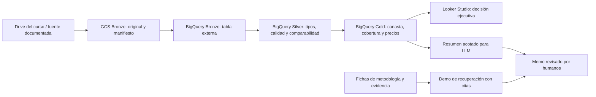

# Rediseño de Especialidad: de precios dispersos a una decisión defendible

**Versión:** 0.4 · **Fecha:** 2026-11-05 · **Estado:** propuesta para revisión.

**Confirmado:** Especialidad primero; 8 sesiones × 180 minutos; perfil ejecutivo; práctica guiada en GCP con crédito de US$300; proyecto integrador; HTML interactivo; SQL con `employees` en MariaDB. El usuario confirmó **PROFECO: precios y decisiones de compra** como caso guiado. **Aclaración posterior:** el proyecto final usa un dataset distinto por equipo; solo estamos desarrollando Especialidad. ML se limita a 10 minutos conceptuales del syllabus, sin entrenamiento, laboratorio ni entregable predictivo.

La propuesta sustituye la secuencia anterior de 9 sesiones más nivelación. Conserva la intención del syllabus moderno y adelanta SQL para que el alumnado comprenda las transformaciones antes de ejecutarlas. Los originales permanecen disponibles durante el rediseño.

**Estado de producción:** ocho sesiones de Especialidad implementadas localmente (203 slides: S1–S7 rediseñadas; S8 base), con guías y recursos ilustrativos. Abrir [índice del curso](presentaciones-v2/index.html); consultar [alcance y validación](presentaciones-v2/README.md). No hay validación end-to-end cloud ni paquetes reales perfilados por equipo.

La propuesta detallada está en [slides y laboratorios](PROPUESTA_SLIDES_ESPECIALIDAD.md), con ocho guiones, y en el [contrato de proyectos diversos](docs/rediseno-especialidad/proyectos-diversos.md). El usuario pidió superar la repetición visual del lote inicial. La [revisión editorial S1–S7](docs/rediseno-especialidad/propuesta-editorial-s01-s03.md) aplica su kit y el [syllabus exclusivo de Especialidad](docs/rediseno-especialidad/syllabus-especialidad-fuente.md).

## 1. Resultado que buscamos

Al terminar, cada equipo podrá defender una decisión con datos a escala: formular la pregunta, describir una arquitectura, verificar calidad, consultar, comunicar un hallazgo y reconocer límites de costos y de IA. Podrá leer y adaptar SQL acotado sin desarrollar un sistema de ingeniería completo.

**Pregunta del caso guiado PROFECO:** «Con los precios observados en un periodo histórico, ¿qué establecimiento o zona ofrece una canasta comparable y con qué cobertura y confiabilidad podemos sostener esa comparación?»

Durante el ejemplo guiado, el alumnado actúa como un equipo asesor de compras; en el proyecto propio elige otra decisión y otro dataset. La situación inicial son archivos grandes con precios heterogéneos; la situación deseada es una recomendación rastreable desde el dashboard hasta la fuente. Elegir si la canasta debe comprarse en un mismo establecimiento o puede repartirse entre varios forma parte del contrato de la decisión.

**Límites de la evidencia:** precios observados no prueban inventario, ventas ni hábitos de compra. No se calcularán ingresos, margen, ticket promedio ni inflación oficial. El periodo de los archivos se verificará; las recomendaciones se presentarán como retrospectivas cuando corresponda. No se rellenarán productos faltantes como si fueran gratuitos.

## 2. Arquitectura que construirán

Es una implementación docente de **Medallion con GCS y BigQuery**. No se presentará como un lakehouse completo con tablas abiertas, transacciones sobre el lago o time travel solo por tener tres capas. La comparación warehouse/lake/lakehouse se enseña, y la implementación de Iceberg/Delta queda para Maestría.

**Separación de experiencias:** `employees` se usa en la sesión 2 para SQL en un entorno conocido; PROFECO se usa desde la sesión 1 como problema y desde la 3 como laboratorio incremental. El docente prepara MariaDB y carga `datacharmer/test_db` antes de clase; el alumnado se conecta y consulta. No dedicar la sesión SQL a instalar una VM.

## 3. Mapa de ocho sesiones

La tabla describe el ejemplo guiado. Cada sesión incluye 30 minutos de transferencia al **dataset distinto de cada equipo**; sus KPIs/entregables se adaptan al dominio y los hitos se evalúan sobre ese proyecto propio. No se exige una canasta a quien estudia préstamos de biblioteca o reseñas.

| Sesión | Pregunta de apertura y teoría central | Laboratorio guiado | Evidencia incremental |
|---|---|---|---|
| **1. Una decisión necesita una arquitectura** | ¿Por qué dos archivos pueden sugerir compras distintas? Big Data vs. cloud; volumen/velocidad/variedad/calidad/valor; OLTP/OLAP; warehouse/lake/lakehouse; paralelismo, batch vs. streaming y mapa Medallion | Proyecto GCP, verificación de crédito y presupuesto, bucket; abrir muestra e inventario; registrar pregunta, responsable y periodo | **H1:** ficha de decisión, mapa inicial y entorno preparado |
| **2. SQL para hacer preguntas precisas** | ¿Quién cuenta como empleado actual? Tabla, fila, llave, grano; filtros, agregaciones y joins | `employees` en MariaDB: `SELECT`, `WHERE`, `ORDER BY`, `COUNT`, `GROUP BY`, `HAVING`; `INNER/LEFT JOIN` con apoyo visual y fechas de vigencia | **H2:** 6 consultas comentadas y explicación de un conteo inflado |
| **3. Bronze conserva la evidencia** | ¿Cómo consultamos millones de precios sin moverlos a una laptop? Almacenamiento/cómputo separados, ETL/ELT, esquema, procedencia y costo por lectura | Copiar muestra preparada a GCS, crear `curso_bronze` y preparar el contrato de las capas siguientes, registrar manifiesto y tabla externa; consultar columnas explícitas y comparar muestra/fuente grande | **H3:** Bronze consultable, manifiesto, esquema y registro de escala/costo |
| **4. Silver hace comparables los precios** | ¿Un precio inválido puede cambiar la recomendación? Contratos, tipos, nulos, duplicados, frescura, trazabilidad y responsabilidades | SQL suministrado con `SAFE_CAST`, normalización de texto y fecha, reglas de precio; separar rechazados; crear tabla Silver particionada cuando proceda | **H4:** Silver + reporte de calidad reconciliado + registro de exclusiones |
| **5. Gold traduce datos en una decisión** | ¿La canasta más barata está completa? Grano analítico, dimensión/hecho, agregación, joins y definición de KPI | Crear catálogo de canasta con cantidades y unidades; cruzar con Silver; calcular cobertura y costo bajo una regla de selección explícita; tabla Gold y consulta acotada por periodo | **H5:** Gold, diccionario de 3–5 KPIs, control de fan-out y costo observado |
| **6. Un dashboard debe conducir a una acción** | ¿Qué debería decidir la audiencia al verlo? Contexto, comparación, jerarquía y evidencia según Cole Nussbaumer Knaflic | Looker Studio conectado a Gold; tarjetas de costo/cobertura, barras comparables, evolución cuando haya cobertura, filtros de periodo/zona; rediseño antes/después | **H6:** dashboard interactivo + recomendación de una página con alcance y reservas |
| **7. GenAI aporta hipótesis; la evidencia decide** | ¿Cómo detectamos una explicación inventada? Distinción conceptual breve entre predicción y generación; LLM, grounding, RAG, privacidad, evaluación y costo | Resumen Gold acotado en la interfaz de prompts disponible en GCP; contrastar respuesta libre con respuesta basada en evidencia; demo guiada de recuperar fichas y exigir citas; auditoría de afirmaciones | **H7:** memo ejecutivo, prompt, evidencia y tabla de afirmaciones verificadas/refutadas |
| **8. Defender la decisión ante un comité** | ¿Qué tendría que ser cierto para aprobar la propuesta? Arquitectura, valor, gobernanza, costo y límites | Presentación y defensa del proyecto; auditoría cruzada del dato al KPI; cierre de recursos y plan de mejora | **H8:** paquete reproducible, defensa y registro de cierre |

Cada sesión enseña una elección de arquitectura y la conecta con la escala. SQL y visualización son medios para trabajar sobre grandes datos; no reemplazan la discusión de distribución, costo, calidad y latencia.

## 4. Agenda de 180 minutos por sesión

| Sesión | 0–15 min | 15–45 min | 45–65 min | 65–75 min | 75–130 min | 130–160 min | 160–180 min |
|---|---|---|---|---|---|---|---|
| **1** | Dilema y diagnóstico | Mapa Big Data/cloud y almacenamiento | Caso externo + arquitectura progresiva | Pausa | Alta/verificación GCP, presupuesto y bucket | Explorar inventario; formular decisión y mapa | H1, acceso de respaldo y cierre |
| **2** | Pregunta de nómina | `SELECT/WHERE/ORDER BY` con mini-tablas | Agregados, grano y relación entre tablas | Pausa | 6 ejercicios progresivos en `employees` | Depurar un join que multiplica filas | H2 y puente de MariaDB a BigQuery |
| **3** | Archivo grande, equipo pequeño | ETL/ELT, Bronze y esquema | Demo muestra vs. volumen; bytes y ubicación | Pausa | GCS, manifiesto y tabla externa | Consultar y registrar métricas de escala | H3 y reconciliación de accesos |
| **4** | Precio erróneo, decisión errónea | Calidad y reglas de comparabilidad | Limpieza comentada + propietario de dato | Pausa | Silver, rechazados y partición | Auditoría de calidad y efecto en KPI | H4 y lectura del contrato |
| **5** | Barato vs. incompleto | Grano, modelo y fórmulas KPI | Join correcto vs. fan-out | Pausa | Canasta, cobertura y tabla Gold | Validación de totales y costo de consulta | H5 y ensayo de recomendación |
| **6** | Dashboard que confunde | Principios de comunicación visual | Caso externo y rediseño interactivo | Pausa | Construir y filtrar Looker Studio | Prueba de comprensión entre equipos | H6 y conclusión accionable |
| **7** | Respuesta convincente y falsa | GenAI/RAG; ML solo como distinción conceptual breve | Caso externo + demo de recuperación | Pausa | Generación de memo y comparación | Verificar citas, cifras y contraejemplos | H7 y evaluación del uso de IA |

Las franjas son 15 + 30 + 20 + 10 + 55 + 30 + 20 = **180 minutos**. Incluir microinteracciones dentro de la teoría; evitar exposiciones continuas de 50 minutos. Los 55 minutos de laboratorio se dividen en 4–6 pasos con comprobación. El trabajo pesado de carga ocurre antes de clase.

**Sesión 8:** 0–15 encuadre; 15–65 hasta 5 defensas; 65–75 pausa; 75–125 hasta 5 defensas; 125–155 auditoría cruzada; 155–170 cierre de recursos; 170–180 retroalimentación. Cada defensa: 7 minutos + 3 de preguntas. Capacidad: **10 equipos**; si el grupo exige más, ajustar formato antes de convocar, no prometer 15 minutos a cada equipo dentro de 3 horas.

## 5. Datos y escala real

### Selección confirmada

`all_data.csv` del Drive es la fuente candidata principal. El catálogo reporta `19706.44` en `tamanio_mb`; no se infiere la unidad binaria/decimal exacta de ese campo. La interfaz del Drive lo muestra como 19.24 GB. Es un dataset del orden de **19 GB**, no una medición de bytes efectivamente procesados en BigQuery.

El repositorio describe 15 campos de precios PROFECO (`producto`, `presentacion`, `marca`, `precio`, `fechaRegistro`, geografía, etc.); **falta verificar el archivo** antes de cerrar el SQL. El catálogo no contiene columnas, llaves, fechas observadas ni licencia. `quien_es_quien.csv` queda como comparación opcional; no se presume que sea una copia ni una versión anterior equivalente por compartir columnas.

### Preparación docente previa a producir los labs

1. Obtener una muestra y perfilar encabezado, delimitador, comillas, encoding, fechas, nulos y precios; comprobar origen y condiciones de uso.
2. Establecer el grano de una observación y la clave de comparabilidad. No confundir registros repetidos válidos con duplicados.
3. Seleccionar un periodo y una zona con cobertura suficiente para una canasta de 5–10 productos. No sumar gramos, piezas y litros como si fueran la misma unidad.
4. Preparar una muestra de 50–100 MB como objetivo operativo, validando que conserve cobertura de la canasta; publicar su criterio de selección, checksum y conteos. No muestrear un CSV a base de cortar líneas si contiene texto multilínea.
5. Preparar el archivo completo en GCS **una vez**, junto con esquema y manifiesto. Cada equipo debe poder ejecutar al menos una consulta acotada sobre la fuente grande, si permisos/licencia/costo lo permiten, registrando bytes, filas, tiempo, filtros y cache hit.
6. Usar Silver nativa para los ejercicios repetidos y Gold pequeña para BI. No escanear el CSV completo en cada refresco del dashboard.

**Demostración de escala:** contrastar la misma pregunta en muestra y volumen completo, y comparar proyección de columnas y filtro de partición en tablas nativas. No atribuir una mejora al `LIMIT` ni prometer que una tabla externa CSV evita lecturas por filtrar fechas. Desactivar o registrar caché al comparar; un resultado más rápido no prueba por sí mismo una mejor arquitectura.

**Plan de contingencia:** si falla el acceso grande, continuar con la muestra y evidencia de una ejecución docente previa, identificada como tal. Esa evidencia no se contará como ejecución del alumno.

## 6. Contratos de los laboratorios

Cada sesión tendrá `slides.md`, `laboratorio.md`, `notas-docente.md`, código descargable y referencias, bajo una ruta v2 independiente de la actual. El formato propuesto para cada paso:

| Campo | Qué debe recibir el alumno |
|---|---|
| Objetivo | Acción de negocio o técnica que está comprobando |
| Antes de empezar | Recurso, permisos, dataset y paso previo |
| En pantalla | Servicio y ruta de navegación, con fecha de revisión de UI |
| Haz esto | Un paso concreto; evitar «configura lo necesario» |
| Código | Bloque completo, motor SQL indicado, nombres coherentes y parámetros definidos una sola vez |
| Debes observar | Conteo o propiedad verificable; no inventar una captura de éxito |
| Si falla | Causa frecuente y recuperación concreta |
| Guarda | Consulta, evidencia o recurso para el proyecto |
| Al terminar | Qué permanece y qué se detiene/expira |

El SQL suministrado tendrá versiones por motor. En la sesión 2, `employees`, `salaries`, `dept_emp` y `titles` incluyen historia: un join sin vigencias puede multiplicar filas. Usar una fecha de corte o el marcador de vigencia definido por el dataset; no confundir `MAX(salary)` histórico con sueldo actual. Contar personas por `emp_no`, no por nombre.

En Gold, preferir **CTAS (`CREATE TABLE AS SELECT`) o vista lógica**. Ventanas y CTEs avanzadas son extensiones comentadas; no constituyen una tarea de programación desde cero para Especialidad. No copiar la propuesta de vista materializada incremental con funciones de ventana del syllabus sin adaptación: tiene restricciones de sintaxis documentadas.

**Contrato inicial de KPIs a revisar con la muestra:**

- Cobertura de canasta = productos requeridos con observación comparable / productos requeridos.
- Costo de canasta = suma de precio unitario comparable × cantidad requerida, bajo regla explícita de establecimiento, fecha y selección de precio. Solo etiquetar «canasta completa» con cobertura del 100%.
- Diferencia de costo entre alternativas completas = costo alternativa − costo referencia, con periodo y geografía compatibles.
- Calidad = aceptados/rechazados por regla y cobertura temporal, conservando trazabilidad a Bronze.
- Cualquier «ahorro» es potencial bajo el supuesto de compra, sin incluir traslado, inventario ni promociones no observadas. Una cobertura baja debe impedir o matizar el ranking.

## 7. Narrativa, diseño e interacción

**Arco del curso:** hoy hay cifras dispersas y poco defendibles → podemos construir evidencia confiable → comprobamos cada paso → defendemos una decisión con sus límites. En cada sesión reaparece una duda real: definición, pérdida de filas, comparabilidad, cobertura, costo o alucinación.

Aplicación de **Cole Nussbaumer Knaflic**: audiencia/decisión primero; título con mensaje demostrable; contexto, unidades y periodo visibles; énfasis en una comparación; etiquetas directas y eliminación de ruido. Aplicación de **Resonate de Nancy Duarte**: alternar problema actual, posibilidad de mejora, obstáculo y prueba; cerrar con una acción que el alumnado puede ejecutar. Son adaptaciones editoriales propias, no reproducciones de sus slides.

**Lenguaje visual:** aprovechar la identidad existente (Source Serif, IBM Plex Sans/Mono, papel/tinta/acento) como punto de partida. Aproximadamente 24–32 slides por sesión 1–7, según contenido; 12–16 en la sesión 8. La guía extensa contiene las instrucciones completas; proyección muestra un concepto o paso legible por pantalla. No convertir párrafos de documentación en diapositivas.

**Interacciones con propósito:**

| Interacción | Ejemplo y aprendizaje |
|---|---|
| Revelado por clic | Ver filas → aplicar filtro → ver agregado; el docente controla el ritmo |
| Diagrama progresivo | Seguir una observación desde Bronze hasta un KPI de Gold |
| Comparación antes/después | Precio imposible que cambia un ranking; explicar qué regla lo detiene |
| Mini-join con filas | Relacionar tarjetas y mostrar por qué un sueldo histórico se duplica |
| Selector de escenario | Canasta incompleta vs. completa; aclarar cuándo son datos ilustrativos |
| Evaluación de respuesta LLM | Resaltar afirmación, localizar evidencia y aceptar/refutar |

Fade de salida/entrada propuesto: 180–280 ms, sin autoplay ni movimiento decorativo continuo. Teclado y clic avanzan primero el paso y luego la slide; retroceso coherente; contador de paso; selección de código no navega. Formularios y enlaces conservan su función. Incluir índice, enlaces profundos, pantalla completa, «mostrar todo», guía de laboratorio paralela, impresión y movimiento reducido. Diagramas SVG/HTML/Mermaid editables, descritos en texto y utilizables sin depender solo del color.

## 8. Casos externos que sí apoyan la teoría

Usar pocos casos y volver a ellos con preguntas distintas; no insertar ocho logos con supuestos de ROI. Cada ficha tendrá fuente, fecha, problema, arquitectura publicada, beneficio reportado, límites y pregunta de transferencia al laboratorio.

| Caso documentado | Dónde se usa | Pregunta para el alumnado |
|---|---|---|
| **Mercado Libre: BigQuery + Looker**, artículo firmado por su líder técnico, 2022 | S1, S3 y S6 | ¿Qué cambia al conectar el almacén analítico con productos de análisis consumibles? Distinguir Looker del Looker Studio usado en clase |
| **Carrefour: colaboración con data clean rooms**, testimonio en anuncio técnico, 2024 | S4 y S5 | ¿Cómo cambia el diseño cuando compartir datos exige controles y responsables? El laboratorio aplica gobierno básico; no implementa una clean room |
| **UPS Capital: BigQuery, Looker, Vertex AI y Striim**, artículo de responsables de UPS Capital/Striim, 2024 | S1 y S7 | ¿Qué decisión necesita datos actualizados y qué papel distinto cumplen analítica y modelos? No presentar el caso como prueba de RAG |
| **Carrefour: Marketing Studio con Vertex AI**, caso incluido en recopilación de Google Cloud | S7 | ¿Qué partes del trabajo generativo requieren aprobación y evaluación? Es un caso de marketing, no una validación del memo PROFECO |

Las referencias están en [fuentes.md](docs/rediseno-especialidad/fuentes.md). Las afirmaciones comerciales se atribuyen al publicador; no se presentarán como evaluación independiente ni se trasladarán porcentajes de beneficio al proyecto de clase.

## 9. Proyecto integrador y evaluación propuesta

**Equipos de 2–3 personas**, ajustable al tamaño del grupo. Cada equipo trabaja con un **dataset distinto y una pregunta propia**. PROFECO es el ejemplo de las clases, no el proyecto final obligatorio. Antes de terminar S2 se registra fuente, grano, acceso y viabilidad. El docente prepara paquetes diferenciados y consultas base para evitar ingeniería desde cero. No asignar el mismo origen bajo distintos formatos o filtros como si fueran datasets independientes. El contrato de entrega y la rúbrica son comunes; los KPIs dependen del dominio. No hay modelo de ML obligatorio ni puntos por entrenamiento o precisión predictiva.

Paquete final:

1. Memo ejecutivo de 2–3 páginas: pregunta, hallazgo, recomendación, alcance histórico, incertidumbre y siguiente acción.
2. Diagrama arquitectónico + matriz breve de gobernanza: origen, dueño, accesos, calidad, retención y linaje por capa.
3. Manifiesto de datos, reglas Bronze/Silver/Gold, SQL guardado y evidencia de consultas/costo. Anexar instrucciones reproducibles.
4. Dashboard Looker Studio con 3–5 KPIs, filtros y una conclusión visible. Entregar captura/PDF como respaldo si el acceso compartido falla.
5. Anexo de IA: prompt, evidencia, respuesta, comprobación y errores detectados; si el servicio no estuvo disponible, usar la alternativa docente y explicitarlo.
6. Defensa de 7 minutos y preguntas; cada integrante explica al menos una decisión y una limitación.

| Criterio propuesto | Puntos |
|---|---:|
| Pregunta, valor y coherencia de la recomendación | 20 |
| Arquitectura Medallion, gobernanza y trazabilidad | 20 |
| SQL, calidad y validez de KPIs (sin doble conteo) | 25 |
| Dashboard y claridad narrativa | 20 |
| Evaluación crítica de GenAI | 10 |
| Reproducibilidad y registro de costos/cierre | 5 |
| **Total** | **100** |

Esta es la rúbrica del proyecto, no una sustitución automática de la evaluación institucional. El repo anterior menciona examen, ponderaciones y mínimo de ≥15 GB: **confirmar vigencia** antes de editar documentos oficiales. Los hitos H1–H7 se retroalimentan y forman el proyecto, evitando siete entregas ajenas al cierre.

## 10. Operación de GCP dentro del crédito

El crédito de prueba vigente documentado es US$300 durante 90 días para cuentas elegibles. Verificar estado individual antes de iniciar; tener cuenta de respaldo docente. No confundir Google AI Studio/Gemini API con el servicio de modelos de GCP: el crédito no cubre automáticamente cualquier producto o modelo.

**Objetivo operativo propuesto, no cotización:** planear la ruta base de Especialidad por debajo de US$60 por equipo/proyecto, y revisar consumo en cada sesión. Reservar el resto del crédito para variaciones y contingencias; no hay obligación de gastarlo. Antes de cerrar labs, calcular presupuesto con región, volumen, número de ejecuciones, almacenamiento, VM y modelo elegidos. Si los créditos son individuales, cada persona conserva su cuenta; el trabajo en equipo no implica combinar saldos.

- Proyecto de laboratorio identificable y recursos en una región compatible; GCS y BigQuery sin desajuste de ubicación.
- Presupuesto y alertas (p. ej., US$15/30/45/60 de consumo bruto operativo), distinguiendo costo de consumo de crédito restante. Las alertas **no son un tope**.
- SQL con columnas explícitas, dry run cuando aplique, límite de bytes y cuotas adecuadas. Para tablas externas verificar las limitaciones de estimación; no asumir que el dry run demuestra costo nulo.
- MariaDB preparada por el docente y activa solo en el horario necesario; detener VM después. Los discos/otros recursos pueden seguir generando costo.
- Expiración de tablas temporales y política de limpieza apropiada; no automatizar borrados del proyecto compartido del docente.
- LLM: modelo disponible y elegible, pocas llamadas, resumen pequeño y límite de salida. Registrar modelo/fecha y consumo; no fijar un identificador en los slides hasta verificarlo.
- Si fallan permisos/cuota/modelo, práctica con resultados y evidencia docente previamente capturados. No obligar a migrar a cuenta de pago para aprobar.

El sitio ya usa **Firebase Hosting** (`presentaciones/dist/`) para servir HTML. Firestore soporta el reto SQL. La nueva presentación puede seguir siendo estática; la publicación vendrá después de su revisión y validación.

## 11. Producción por cortes revisables

| Corte | Resultado concreto | Criterio para avanzar |
|---|---|---|
| **0. Revisión y plan — este corte** | Diagnóstico, fuentes, programa de 8 sesiones, recuperación y storyboard S1 | Revisar distribución, alcance y propuesta de evaluación; PROFECO ya confirmado |
| **1. Contrato de datos y piloto visual** | Muestra perfilada, esquema, KPIs y un piloto HTML de 8–12 slides representativas de S1 | Ver en navegador: teoría, diagrama, revelado por clic, fade y un paso de lab; validar estilo y ritmo |
| **2. S1–S2 completas** | Onboarding, SQL `employees`, guías, código y notas | Ensayo de 180 minutos por sesión; SQL ejecutado en MariaDB y conexión de alumnado comprobada |
| **3. S3–S5 completas** | Bronze/Silver/Gold y demo de escala | Ejecución GCP con evidencia, reconciliación, canasta completa y costo registrado |
| **4. S8 completas** | Dashboard, GenAI/RAG didáctico, defensa y rúbrica | Datos a dashboard a memo rastreables; contingencias probadas |
| **5. Revisión integral y publicación** | 8 decks, guías, recursos y sitio desplegable | Revisión visual y pedagógica, enlaces, código, accesibilidad, presupuesto y despliegue solicitado |
| **6. Maestría** | Plan técnico de 8 sesiones basado en el mismo syllabus | Aprovechar datos y componentes validados; diseñar PySpark, streaming y ML/RAG con alcance realista |

No generar ocho decks en bloque antes de probar el piloto: los resultados de ritmo, datos e interacción deben alimentar la producción. Esto responde a la secuencia solicitada de plan → revisión → slides.

**Propuesta técnica:** crear fuentes v2 aisladas y un manifiesto explícito de ocho sesiones, con componentes visuales reutilizables. Decidir en el piloto si basta evolucionar el reproductor existente. Mantener sitio/IDs actuales mientras se trabaja; el generador actual tiene bucles y pruebas fijados en 25 decks, y concatena múltiples archivos con heurísticas. Esa migración es una tarea explícita, no un cambio de CSS.

## 12. Qué falta revisar juntos

- Distribución propuesta: SQL completo en S2; Bronze/Silver/Gold en S3–S5; visualización en S6; GenAI en S7; defensa en S8.
- Número de alumnos/equipos y disponibilidad de crédito individual, para dimensionar MariaDB y las defensas.
- Vigencia de reglas institucionales anteriores: evaluación, extensión documental y mínimo de volumen.
- Alcance del piloto visual y estilo base. Hay un [storyboard de S1](docs/rediseno-especialidad/storyboard-sesion-01.md) para discutir con ejemplos concretos.

La revisión de estos puntos no impide perfilar datos ni preparar assets locales; sí evita asumir como oficiales ponderaciones o requisitos que no se han confirmado.
